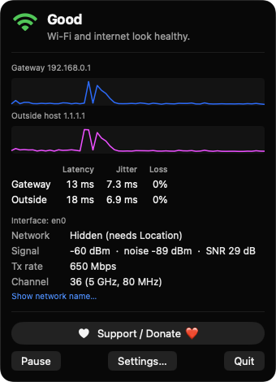
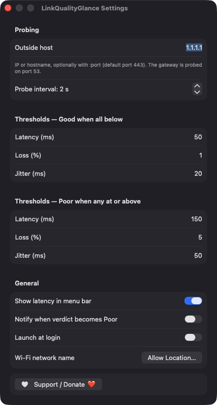
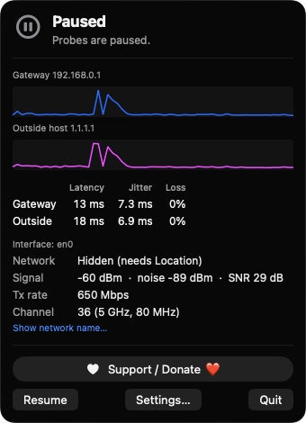

# LinkQualityGlance

**🌐 Website:** [turhe123.github.io/link-quality-glance](https://turhe123.github.io/link-quality-glance/)

A menu bar verdict on your Wi-Fi health from gateway latency, packet loss, jitter and signal quality.


## Why

On a video call and something feels off: is it your Wi-Fi, or your internet provider? LinkQualityGlance is a free, open-source, 100% native, backend-free alternative to paid utilities in the *System Monitoring* category, inspired by tools such as MacWiFi ($10 one-time). It runs entirely on your Mac, has no accounts, no servers and no analytics, and boils everything down to a single Good / Check / Poor verdict in your menu bar.

## Features

- **Menu bar verdict**: a Wi-Fi glyph colored by the current verdict (green Good, orange Check, red Poor, gray for Offline, Paused or Measuring), with an optional average latency readout next to it.
- **Two probe targets**: the default gateway (port 53) and an outside host of your choice (default `1.1.1.1`, port 443 unless you specify `host:port`).
- **No raw sockets**: probes time a short TCP handshake with a 1 second timeout, and timeouts count as loss. A refused connection still counts as a reply, since it proves reachability.
- **Rolling 60-sample window** per target, with average latency, jitter (mean difference between consecutive samples) and packet loss. It shows "Measuring" until at least three samples exist.
- **Plain-language explanation**: the rules engine tells gateway trouble (hints at Wi-Fi or your local network) apart from outside-host-only trouble (hints at your provider), and flags weak signal (RSSI below -72 dBm or SNR below 20 dB).
- **Live sparklines** for the gateway and the outside host, plus a table of latency, jitter and loss.
- **Wi-Fi details**: network name (optional), signal, noise, SNR, transmit rate and channel with band and width, read through CoreWLAN. Ethernet or non-Wi-Fi connections still show latency.
- **Active interface** is shown, which helps when a VPN takes over the default route.
- **Editable thresholds**: Good when latency, loss and jitter are all below your limits; Poor when any is at or above its limit. Defaults are 50 / 1% / 20 ms for Good and 150 ms / 5% / 50 ms for Poor.
- **Settings**: outside host, probe interval (1 to 10 s), thresholds, show latency in menu bar, notify when verdict becomes Poor (5 minute cooldown), launch at login.
- **Sleep and network aware**: probes pause during sleep, windows are cleared on wake and on connectivity changes to avoid false loss.
- **Pause / Resume**, `⌘,` for Settings, `⌘Q` to quit.
- Menu bar only (no Dock icon), universal binary (Apple silicon and Intel).

## Screenshots

<p align="center"></p>

<p align="center"><em>The menu bar popover gives a Good verdict, with live latency sparklines for the gateway and outside host, latency/jitter/loss stats, and Wi-Fi signal, Tx rate and channel details.</em></p>

<p align="center"></p>

<p align="center"><em>Settings let you choose the outside host and probe interval, tune the Good and Poor thresholds, and turn on the menu bar latency readout, notifications and launch at login.</em></p>

<p align="center"></p>

<p align="center"><em>Pausing stops the probes and keeps the last measurements on screen until you click Resume.</em></p>

## Install

1. Download `LinkQualityGlance-macOS.zip` from the [latest release](https://github.com/turhe123/link-quality-glance/releases/latest).
2. Unzip it and move `LinkQualityGlance.app` to `/Applications`.
3. The app is open source and not notarized, so clear the quarantine flag:

   ```bash
   xattr -cr /Applications/LinkQualityGlance.app
   ```

4. The first time, right-click the app and choose **Open**.

Requires macOS 14 (Sonoma) or later.

## Build from source

You need Xcode 15 or later.

```bash
brew install xcodegen
xcodegen generate
xcodebuild -project LinkQualityGlance.xcodeproj -scheme LinkQualityGlance -configuration Release -derivedDataPath ./build build
```

The app is produced at `build/Build/Products/Release/LinkQualityGlance.app`. There are no third-party dependencies, only Apple frameworks: SwiftUI, AppKit, CoreWLAN, Network, SystemConfiguration, CoreLocation, UserNotifications and ServiceManagement.

## Permissions

LinkQualityGlance asks for very little, and the verdict works without any of it:

| Permission | Required? | Why |
| --- | --- | --- |
| Location | Optional | macOS only reveals the Wi-Fi network name (SSID) to apps with Location access. Your location is never read, stored or shared. Without it the name shows as hidden. |
| Notifications | Optional | Only requested if you turn on "Notify when verdict becomes Poor". |
| Login item | Optional | Only used if you turn on "Launch at login" (via `SMAppService`). |

It does **not** request Accessibility, Screen Recording or Microphone access. Network traffic is limited to small TCP connection probes to your gateway and the outside host you configure.

## Support ❤️

If this app saves you some head-scratching, you can support its development:

[Support Or (Leo) Davidai ❤️ on Ko-fi](https://ko-fi.com/leodavidai)

The app also has a "Support / Donate ❤️" button in its dropdown and Settings.

## License

MIT © Or Davidai Bachar
